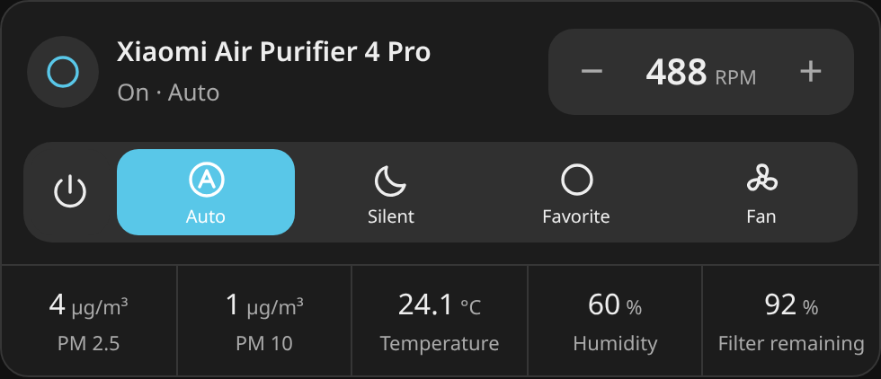

# Xiaomi Purifier Card

A Home Assistant dashboard card for Xiaomi air purifiers, built with TypeScript and Lit. Based on [Purifier Card by Denys Dovhan](https://github.com/denysdovhan/purifier-card), with preserved MIT attribution.


## Features

- Compact header with purifier name, state, measured fan speed, and step controls.
- Automatic PM2.5, PM10, temperature, humidity, and filter-remaining discovery from the selected purifier’s HA device.
- A simple power/preset strip and responsive statistics; no purifier image or decorative dial.
- Separate sensor and number entities update without reloading the dashboard.
- Shortcuts for native percentages, discrete levels, RPM, or custom action sequences.
- Numeric range/step validation, ordered commands, and visible command errors.
- Optional denser spacing, Jinja statistic templates, translations, and `--pc-*` theme variables.
- Visual editor for the main reading, statistics, and appearance; custom shortcuts and templates can be configured in YAML.



Preview uses simulated states and lightweight stand-ins for HA card/icon elements. [Phone preview](docs/preview-mobile.png).

## Compatibility

Initial target: **Home Assistant 2026.10.4**. The purifier must already be integrated into HA and expose a `fan` entity. The card does not connect directly to Xiaomi devices and needs no additional account, access token, or backend.

The design supports Xiaomi model differences through entity capabilities and explicit configuration, rather than a fixed model whitelist. Controls can use `fan.set_preset_mode`, `fan.set_percentage`, `number.set_value`, and other HA services. Unsupported sensors are optional. A card cannot add a control that the integration does not expose.

The 4 Pro and 3C examples are covered by automated tests with **simulated HA state**. Actual operation on physical devices still needs verification. No claim is made that every Xiaomi model or integration has been hardware tested.

## Install with HACS

1. Open **HACS → ⋮ → Custom repositories**.
2. Add `https://github.com/nemke/xiaomi-purifier-card`, category **Dashboard**.
3. Find **Xiaomi Purifier Card** and download a release.
4. Reload the frontend. Check that a JavaScript module resource exists at `/hacsfiles/xiaomi-purifier-card/xiaomi-purifier-card.js`. Add it manually if your resources are managed in YAML.
5. Add a card using `type: custom:xiaomi-purifier-card`.

```yaml
type: custom:xiaomi-purifier-card
entity: fan.your_purifier
stats:
  - entity_id: sensor.your_purifier_filter_life_remaining
    unit: '%'
    subtitle: Filter remaining
shortcuts:
  - name: Auto
    icon: mdi:brightness-auto
    preset_mode: Auto
```

HACS installs the compiled JavaScript. It does not require Node.js, npm, or TypeScript on your HA host.

For manual installation, download `xiaomi-purifier-card.js` from a release, copy it to `<config>/www/`, and register `/local/xiaomi-purifier-card.js` as a JavaScript module.

## Migrate from purifier-card

The separate tag means this card can coexist with the original. Start by duplicating your old card and changing only its type to `custom:xiaomi-purifier-card`.

- Existing `aqi`, `stats`, visibility flags, themes, and templates are retained.
- Legacy shortcut `speed: Silent` / `speed: Auto` is accepted as a `preset_mode` alias. Prefer `preset_mode` in new configurations.
- Combined shortcut actions now execute **preset → custom service → percentage**, awaiting each command and stopping on failure. The complete sequence is validated before sending commands. HA service completion does not guarantee that device telemetry has caught up; active highlighting follows reported state.
- Custom services receive their own `service_data` and `target`; a fan target is only inferred for fan-domain services.
- Custom service shortcuts are no longer permanently highlighted. Recognized preset/percentage/number combinations must all match; arbitrary actions can specify `state_entity` and `state`.
- The card uses a compact layout for both existing and new configurations. Plus/minus controls adjust one supported speed step. Tap the header reading to open the percentage slider.
- Supported preset buttons are provided automatically. Custom shortcuts are retained, with missing preset modes added to keep every exposed mode accessible.
- `compact_view` now selects denser spacing; the large image and dial have been removed.

Use [the 4 Pro example](examples/4-pro.yaml) or [the 3C example](examples/3c.yaml) for the supplied entity names. The 4 Pro `fan_level` example selects **Fan**, following the `xiaomi_miio` integration's mode semantics; verify your integration's `preset_modes`. The 3C RPM example selects **Favorite**. Percentage shortcut names in these examples are labels for user-selected settings, not measured airflow percentages.

`filter_life_remaining` is remaining filter life, so it should be labelled **Filter remaining**. `aqi` is the inherited configuration key; displaying PM2.5 concentration does not calculate an air quality index.

## Configuration

The visual editor detects available readings when configuring a purifier. The main reading defaults to measured motor RPM, or the fan’s percentage when RPM is not exposed. PM2.5, PM10, temperature, humidity, and filter remaining are suggested as statistics. Filter life remaining in percent is preferred over remaining days when both are exposed. Detection uses device membership and sensor metadata, so renamed entities are supported. Disabled, missing, or ambiguous sensors are not guessed. Known numeric fan attributes are also supported for older integrations.

For an existing card, click **Detect missing sensors** in the editor. Existing sensor choices, custom labels, units, templates, and shortcuts are preserved. Remove or change any suggestion to override it; state refreshes do not reapply removed defaults. Sensor discovery does not overwrite a field while you are typing.

The visual editor includes **Main reading** and **Statistics** sections. Choose a sensor for the header reading, then use **Add statistic** to add further readings. Each statistic has an editable label and unit, ordering buttons, and a remove button. Sensor inputs offer suggestions from HA; you can also type an entity ID. See the [editor preview](docs/editor.png).

Existing templates, fan attributes, and shortcuts are retained when editing labels, units, or appearance. Choosing a new sensor replaces that row's attribute source. Advanced templates and shortcut actions remain configurable in YAML.

| Option             | Default              | Meaning                                    |
| ------------------ | -------------------- | ------------------------------------------ |
| `entity`           | required             | HA `fan.*` entity                          |
| `name`             | entity friendly name | Optional display name                      |
| `show_name`        | `true`               | Show the name                              |
| `show_state`       | `true`               | Show state; unavailability is always shown |
| `show_preset_mode` | `true`               | Show the fan's exposed preset list         |
| `show_toolbar`     | `true`               | Show power and shortcuts                   |
| `compact_view`     | `false`              | Use denser spacing                         |
| `aqi`              | `{}`                 | Main reading source                        |
| `stats`            | `[]`                 | List of additional readings                |
| `shortcuts`        | `[]`                 | List of control buttons                    |

### Reading sources

Leaving the main reading source empty shows fan speed when the fan exposes a measured motor-speed attribute or percentage. An explicit `aqi` source overrides that default.

Both `aqi` and each statistic accept `entity_id`, `attribute`, and `unit`. Without `entity_id`, an attribute is read from the fan. Combining them reads an attribute of the specified entity. Nested attribute paths are supported. Units default to the source sensor's unit where available. Missing, unknown, and unavailable readings show `—`; real zero values remain zero.

Statistics additionally accept `subtitle` and `value_template`. Templates run through HA's template API and receive `value`:

```yaml
stats:
  - entity_id: sensor.purifier_filter_seconds
    value_template: '{{ (value | float(0) / 3600) | round(1) }}'
    unit: hours
    subtitle: Filter use
```

### Shortcuts

Each shortcut accepts `name`, `icon`, `preset_mode`, `percentage`, `service`, `service_data`, and `target`. Preset names must match a mode exposed by the target entity; case differences are normalized to the reported spelling. Number values are checked against the entity's `min`, `max`, and `step`. Quoted numeric values are accepted and sent as numbers.

```yaml
shortcuts:
  - name: Favorite
    icon: mdi:star
    preset_mode: Favorite
    service: number.set_value
    target:
      entity_id: number.purifier_favorite_level
    service_data:
      value: 7
```

For integrations with a separate mode selector or additional controls, use an explicit `actions` list. If present, this replaces the shorthand actions and runs in the written order:

```yaml
shortcuts:
  - name: Sleep
    icon: mdi:weather-night
    actions:
      - service: select.select_option
        target:
          entity_id: select.purifier_mode
        service_data:
          option: Sleep
    state_entity: select.purifier_mode
    state: Sleep
```

The card disables controls while the fan is unavailable or a command is pending. A failed command stops the sequence and displays the error; completed earlier commands are not rolled back. A timeout does not prove the device ignored a command: check its state before retrying.

## Theming

The card follows HA theme colors. Existing variables are retained:

| Variable                    | Purpose                              |
| --------------------------- | ------------------------------------ |
| `--pc-background`           | Card background                      |
| `--pc-primary-text-color`   | Name and readings                    |
| `--pc-secondary-text-color` | State, labels, units                 |
| `--pc-icon-color`           | Header icons                         |
| `--pc-slider-path-color`    | Legacy track color                   |
| `--pc-slider-bar-color`     | Active preset and speed-slider color |
| `--pc-toolbar-background`   | Toolbar background                   |
| `--pc-toolbar-text-color`   | Toolbar text                         |
| `--pc-toolbar-icon-color`   | Toolbar icons                        |
| `--pc-divider-color`        | Separators                           |
| `--pc-spacing`              | Base spacing, default `10px`         |

Override them through a theme or optional card-mod styling:

```yaml
card_mod:
  style: |
    ha-card {
      --pc-background: #18242b;
      --pc-spacing: 12px;
    }
```

## Languages and development

Retains English, Ukrainian, Turkish, French, Norwegian Bokmål, Polish, Bulgarian, simplified/traditional Chinese, German, Catalan, Russian, Italian, Czech, Dutch, Spanish, Slovak, and Portuguese with English fallback. New translations should receive native-speaker review.

See [CONTRIBUTING.md](CONTRIBUTING.md) for Node 24/npm 11 development, automated checks, local preview, and release instructions.

## Credits and license

MIT, original copyright © 2020 Denys Dovhan. See [LICENSE](LICENSE). Original card inspired by [MacBury Smart House](https://github.com/macbury/SmartHouse). Legacy purifier artwork remains in the source repository but is no longer bundled by the compact card; its documented provenance is [the upstream animation section](https://github.com/denysdovhan/purifier-card#animations).
