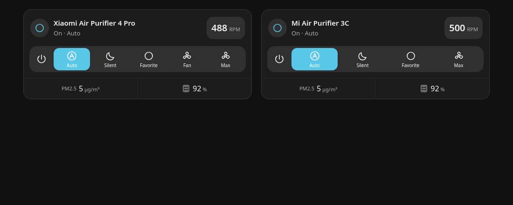
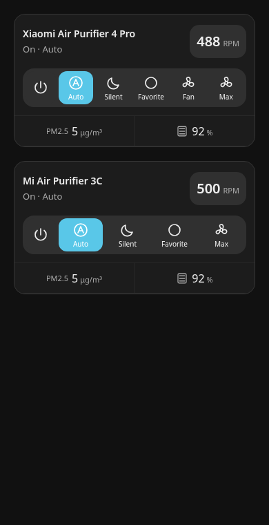

# Default Max action

Breeze v0.1.15 adds Max automatically to fan entities that support native
percentage speed control. Existing card configurations gain the action after
updating and reloading the frontend.

On Xiaomi 4 Pro, Max selects Fan and then requests 100%, which the core
xiaomi_miio integration maps to Fan level 3. On Xiaomi 3C, it selects Favorite
and then 100%, which that integration maps to 2200 RPM. The card does not
hardcode either speed value. Purifiers with other integrations use native
percentage control, with Fan/Manual/Favorite selected first when exposed.

The action awaits each command and stops on a failed command. An off purifier
is started first. The active state follows the reported mode and percentage;
it does not claim physical RPM confirmation. The RPM readout continues to use
the integration's measured value, with the existing best-effort refreshes.

The default action does not alter what Auto or Silent mean. Favorite continues
to be a saved manual setting, rather than a synonym for maximum speed. Using
Max on a 3C changes its saved Favorite speed to the maximum.

To hide the default action, use the checkbox under Modes and shortcuts or:

```yaml
show_max_speed: false
```

Custom shortcuts remain intact. A custom shortcut named Max replaces the default.
On narrow cards using the automatic toolbar layout, Max is available in the
action dropdown alongside the other shortcuts.

The browser previews use simulated Home Assistant state, not physical device
measurements. Regression coverage includes both Xiaomi mode sequences, generic
percentage fans, power-on, repeat requests, mode rejection, confirmation, mobile
dropdown operation, and the editor's hide setting.





Integration reference:
https://github.com/home-assistant/core/blob/2026.11.1/homeassistant/components/xiaomi_miio/fan.py
