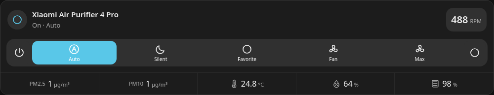

# Buttons on phones

Breeze v0.1.16 keeps all actions visible when Toolbar style is Buttons. Controls
that do not fit in one row form a balanced grid with no horizontal scrolling.
The standard 4 Pro controls (power, Auto, Silent, Favorite, Fan, Max, settings)
fit into two rows at the tested 320px, 375px and 480px viewport widths.

Power and settings no longer pin themselves over scrolled mode buttons. There
is no swipe hint, and mode labels can wrap within their own button. The desktop
toolbar stays on one row when there is sufficient room. Additional custom
actions can add rows; no action is hidden.

In the visual editor, open Modes and shortcuts and select Buttons. In YAML:

```yaml
toolbar_style: buttons
```

Existing cards already configured with Buttons need only the update and a
frontend reload. Automatic keeps its existing narrow-card dropdown behavior,
and Dropdown remains available as an explicit choice.




These previews use simulated HA state. Browser regression tests verify that
all seven controls remain inside the toolbar, do not overlap, are individually
hittable, have at least 44px touch targets, and send the expected commands.
Additional cases cover long labels, extra actions, keyboard use, and resizing
between desktop and phone widths.
